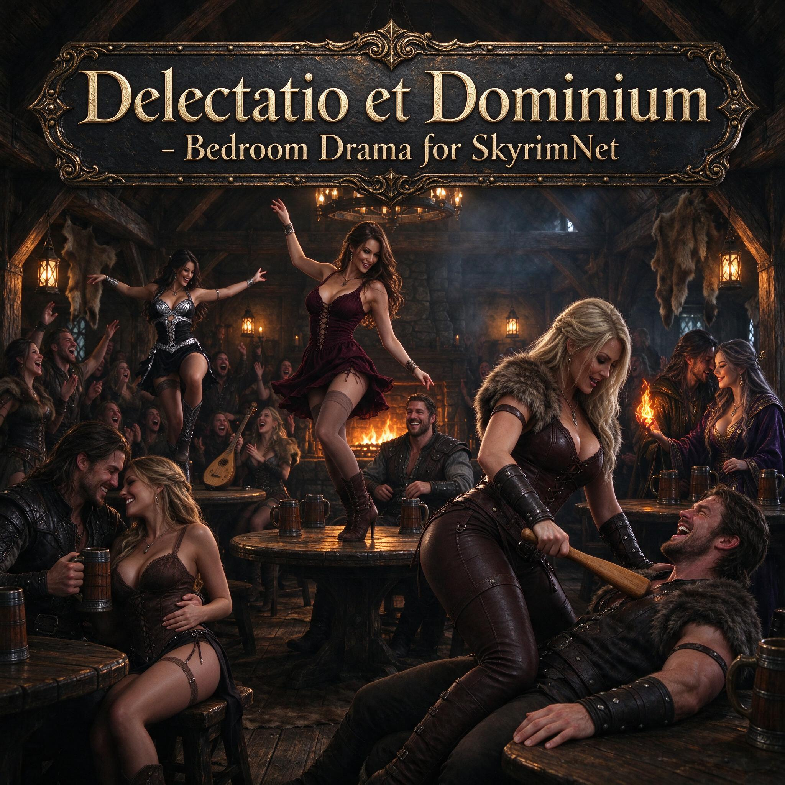

# Delectatio et Dominium

  

**Bedroom drama for SkyrimNet.** DeD v0.3.0-alpha — the first release to carry every
module, in an honest alpha state: tested in-house where possible, and now looking to the
community for help testing the features, giving feedback, and sharing logs to help
diagnose issues.

Delectatio et Dominium (DeD) is a **modular SkyrimNet integration mod for a number of
classic community adult mods and effects**. It aims to immerse you in those mods through
thoughtful integration into [SkyrimNet](https://github.com/goncalo22/SkyrimNet)'s prompt
and trigger systems: the LLM driving your NPCs doesn't just know what's happening — it
reacts as the character would, narrates it in-story, and decides what happens next. In
some instances, DeD even drives the functions itself: applying cum decals, executing
paired animations, and applying tattoos. And it attempts to maintain complete
compatibility with both main adult Skyrim frameworks, **SexLab and OStim** — pick either,
or run both.

The structural idea: a modular framework that can support a number of mods while
requiring as few as one of them. Each module is a separable file-set with a FOMOD
installer option, so you install only what you use.

Everything the LLM narrates is written in-story: cues and ambient narration describe what
is happening as it happens — the model reacts as the character would, never breaking the
scene to explain itself. Nothing fires at random; every interaction and pose is decided by
SkyrimNet's model, in context, from the characters' personalities. Master toggles, an
intensity slider, and per-module settings let you dial everything back.

> ⚠️ **Adult content (18+).** This mod adds non-consensual / NSFW interactions and other
> extreme roleplay themes. See the disclaimer below before installing.

---

## Modules

### Baka Interactions — the interaction core

Walk up to any NPC and the LLM decides what happens: flirtation, harassment, escalation,
capture — narrated in-character the whole way. Every emergent NSFW moment in DeD starts
here.

- **Paired actions through the Interact power** — affectionate, forced, and sexual actions
  targeted at any NPC, a downed victim, a hostile creature, or yourself.
- **Escalation with resistance** — a resist / struggle / submit / call-for-help chain the
  model plays out in context.
- **Capture, tie-up, and slavery** — defeated NPCs can be bound, enslaved, or sold; the
  LLM narrates their state and reactions.
- **Creature escalation** — hostile creatures can be drawn into the same lanes (with your
  installed creature animation packs).
- **The background daemon** — Mephala and Molag Bal modes let dominant NPCs escalate on
  their own initiative, on cadence sliders you set.
- **Execute gate (experimental)** — how the Execute action may be used: unlimited,
  companions ask, or always ask.

### GS Poses — solo posing, made ambient

Any NPC can hold a pose that fits the moment — and NPCs will do it on their own, because
the model decided they would.

- **PrismaUI pose grid** — 19 high-quality pose categories, on the player or any targeted
  NPC.
- **Sanguine Mode** — the background daemon that puts nearby NPCs into mood-fitting poses,
  on a cadence slider you set. Every pick is one consideration pass: the LLM reads the
  live scene and picks both the pose and the exact move.
- **Sheogorath Mode** — raises the ambient intensity when you want a livelier room.
- **Pose narration** — optional pose narration routes, plus per-mode narration toggles
  (default off).
- **Pose gender policy** — female-only / curated / all-poses dropdown.

### Cum (v2) — applied cum, fully narrated

Applied cum becomes part of the story: SkyrimNet sees every application, tracks who or
what applied it, and narrates the aftermath.

- **Full awareness** — fires on the OCum ModEvent path, plus a SexLab end-of-scene proxy;
  unified or per-source firing modes.
- **Appliance authority** — who or what applied it, creatures included.
- **Decal source selection** — a dropdown choosing which decal sets get applied.
- **Ambient follow-up cues** — on an interval you set, with LLM disposition of the
  aftermath: how each character deals with — or deals with having — the cum on them.

### Fill Her Up (v2) — inflation with a voice

[Fill Her Up — Baka Edition](https://www.loverslab.com/files/file/14920-fill-her-up-baka-edition/) inflation, fully narrated, read
live from FHU's own per-actor state.

- **Level-up swelling and level-down release** — every band change narrated as it
  happens, plus creature fills.
- **Ambient narration on by default** — the first cue fires the moment a band is entered,
  then follow-ups on an interval you set.
- **OStim self-drive** — OStim scenes drive their own inflation fills through the built-in
  climax driver; no SexLab bridge required.

### SlaveTats (v2) — the body keeps the story

LLM-driven degradation tattoos: applied with reactions, and noticed by the world around
them.

- **Mark sets** — spank marks, tears, drool, and related sets, applied with NPC and player
  reactions; an in-game set-picker menu for your own choices.
- **Force Tattoo LLM lanes** — a downed-gated Apply action, and a Command action for
  "mark them / brand them" intent.
- **Ambient exposure** — ambient rolls narrating who notices the marks a character is
  wearing, and how they feel about being seen.

### Acheron Bridge — losing a fight becomes a scene

Downed-consequence SkyrimNet triggers bridged to [Acheron](https://www.nexusmods.com/skyrimspecialedition/mods/108159)'s
consequence system — a defeat is the start of a story, not a game over.

- **The downed handoff** — DeD's downed cues feed Acheron's consequence system.
- **Capped cadence** — consequence cues land one at the down moment, a couple in the
  following minute, then go quiet.
- **Downed State MCM page** — configure the lane.

### DeD Service — the quiet machinery

The always-installed service DLL behind the modules: a central state store with
save-game-safe persistence, a single shared scheduler for every ambient pass, and the
event pump the modules talk through.

**Independence model:** every module is presence-gated and independently removable. The
**Independence model:** every module is presence-gated and independently removable. The
FOMOD's module toggles install or remove each module's files (esp, DLL, content pack,
assets); the content layers the framework carries stay installed but inert, so nothing
breaks in any combination — run one module, run them all, or run none.

## Requirements

### Core (always required)

- [Skyrim Special Edition / Anniversary Edition](https://store.steampowered.com/app/489830/The_Elder_Scrolls_V_Skyrim_Special_Edition/) — 1.5.97 or 1.6.x (both verified in-house)
- [SKSE64](https://skse.silverlock.org/) matching your runtime
- [SkyrimNet](https://goncalo22.github.io/SkyrimNet-GamePlugin/) (the LLM framework this mod integrates with — required; Beta 25 / 0.25.x or later)
- [SkyUI / MCM](https://www.nexusmods.com/skyrimspecialedition/mods/12604) — the configuration menu
- [PapyrusUtil](https://www.nexusmods.com/skyrimspecialedition/mods/13048) — settings storage
- [PrismaUI](https://www.nexusmods.com/skyrimspecialedition/mods/134660) — the interaction, pose, and tattoo menus
- [Baka Motion Data Pack](https://www.loverslab.com/files/file/26992-baka-motion-data-pack/) — the paired interaction animations; run **Pandora / FNIS / Nemesis** after installing
- **A safety line, not a requirement:** no module action of any kind ever targets an
  engine-marked child, anywhere in the framework — an absolute boundary, no exceptions,
  independent of any toggle.

**Game version compatibility:** SE 1.5.97 and AE 1.6.x are verified in-house. The DLLs
follow the Address-Library architecture, so loading on the 1.7.104 runtime with matching
SKSE (2.3.1) is expected to work — but has not been verified in-house. Feedback from 1.7
users is welcome.

### Adult animation framework (at least one)

- [SexLab Framework](https://www.loverslab.com/files/file/20058-sexlab-se-sex-animation-framework-v166d-08292026/) and/or **OSex / OStim** — at least one is needed for paired scenes to start (both are supported simultaneously; the MCM picks Auto). Without one, escalation simply won't start a scene — nothing breaks.

### Per-module (only for the modules you install)

- [GSPoses by Gunslicer](https://www.patreon.com/Gunslicer/posts/pose-mod-02-06-159933025?utm_campaign=postshare_fan&utm_content=android_share) — the GS solo-pose animations (GS Poses)
- [Fill Her Up — Baka Edition](https://www.loverslab.com/files/file/14920-fill-her-up-baka-edition/) — inflation (FHU)
- [SlaveTats](https://www.loverslab.com/files/file/619-slavetats/) (includes JContainers) — degradation tattoos (SlaveTats) - Tattoo Packs can be found on the modpage
- [SlaveTats NG](https://www.loverslab.com/files/file/35989-slavetatsng/) - For faster tattoo application - Must install base SlaveTats too
- [Acheron](https://www.nexusmods.com/skyrimspecialedition/mods/108159) — the downed-consequence bridge (Acheron Bridge)
- [OCum](https://www.nexusmods.com/skyrimspecialedition/mods/77506) — applied-cum events (Cum; the SexLab end-of-scene proxy also works without OCum)

Each module is inert without its prerequisite — it greys out in the MCM and does nothing
rather than breaking.

### Soft (strongly recommended)

- **An arousal framework — pick ONE:** OSL Aroused - Arousal Reborn, or SL Aroused (NG). Arousal-aware reactions key on it; if both are present the runtime resolves Aroused Reborn first, then SL Aroused, else runs neutral. (Reborn bundles its own copy of SexLabAroused.esm, so seeing that esm does not by itself mean SL Aroused NG is installed.)
- [Flash Games – Struggling QTE](https://www.nexusmods.com/skyrimspecialedition/mods/121909) — blocking-based QTE for grab/choke holds
- [Dynamic Feminine Female Modesty Animations OAR](https://www.nexusmods.com/skyrimspecialedition/mods/104374) — cover-self reaction (no animations are bundled for this)
- [Additional Expressions Project](https://www.nexusmods.com/skyrimspecialedition/mods/72337) — facial-expression morph values (the values are baked in; the mod itself isn't required at runtime)
- [EmoTears4NPCs / EmoTears](https://www.nexusmods.com/skyrimspecialedition/mods/122296) — animated tears
- [SeverActions – SkyrimNet Action Pack](https://github.com/Severause/SeverActions) — enriches the LLM's downed/capture options; DeD's downed cues invite these outcomes

### Flavor (optional, each degrades gracefully if absent)

- [OCreatures Revived](https://www.loverslab.com/files/file/49059-ocreatures-revived/) — for creature escalation to produce a scene (you also need creature animation packs covering the creature types)
- [Simple Slavery Plus Plus (SS++)](https://www.loverslab.com/files/file/13531-simple-slavery-plus-plus/) — required for the `SellToSlavery` action (defeated **player** only)
- [Follower Slavery Mod (FSM)](https://www.loverslab.com/files/file/23032-follower-slavery-mod-fsm-14122025/) — required for the `EnslaveFollower` action (OFF by default)

## Installation

Install with a mod manager (Mod Organizer 2 recommended): the FOMOD wizard walks you
through the modules and installs only the file-sets you pick.

1. Install and configure the requirements above (SkyrimNet first).
2. Install DeD with MO2 — choose your modules in the wizard. If you were running the
   original SkyrimNet Baka Integration, Animations GS, or Acheron Integration separately,
   remove them first — DeD replaces all three.
3. Run **Pandora / FNIS / Nemesis** so the paired animations register.
4. Launch via SKSE. Each installed module gets a configuration page in the
   **Delectatio et Dominium** MCM.
5. In SkyrimNet's dashboard, verify the `regalrascal.*` / `around906.*` content packs are
   listed, then reload its config (or restart).

Manual install: copy the folders from the archive into your `Data` directory and enable
the ESPs for your chosen modules — but the wizard is the supported path.

## The MCM

Configuration lives in one **Delectatio et Dominium** MCM, split into pages: **Settings**
(master toggles, expression intensity, uninstall/panic reset), **Baka Interactions**
(interactions, escalation, capture, creatures, the Mephala / Molag Bal daemon cadences),
**Cum Effects**, **Fill Her Up**, **Acheron** (Downed State), **SlaveTats**, and
**GS Poses**. Highlights of what you can dial:

- **Master enable + per-module toggles** — every module can be switched off; each greys
  out when its prerequisite mod is absent
- **Expression intensity slider** — how strongly faces react (0.0–1.0)
- **Ambient Cue Interval sliders** (Cum, FHU, SlaveTats) — how often ambient follow-up
  narration fires (15–240 s / 60–1800 s)
- **Daemon cadence sliders** — Mephala / Molag Bal tick intervals, Sanguine / Sheogorath
  tick intervals (15–240 s)
- **Mode-narration toggles** — Sanguine / Sheogorath mode narration (default off), pose
  narration routes on the GS Poses page
- **Pose gender policy** — female-only / curated / all-poses dropdown
- **Decal source selection** dropdown (Cum)
- **Execute gate** — how the Execute action may be used (unlimited / companions ask /
  always ask)
- **Arousal chain** — neutral when no arousal framework is present; otherwise resolves
  Aroused Reborn → SL Aroused

## Honest-state notes

**This is an alpha — and it says so in the version number on purpose.** Everything here
has been built and tested in-house to the extent one person can, but we're not going to
pretend that's the same as battle-tested by a community. Expect rough edges, bugs, and
unbalanced moments. What would help most is you:

- **Test the features** — every module, every lane, and the combinations between them.
- **Give feedback** — what breaks, what feels wrong, what feels missing, what feels great.
- **Share your logs** — when something misbehaves, the SkyrimNet log (and the DeD
  diagnostics in it) is what makes diagnosis possible; a report with a log attached is
  worth ten without.

**EXPERIMENTAL — the Execute action.** The execute-on-downed-victim lane (Baka
Interactions) ships **experimental**: it is heavily guarded (eligibility rules, downed
state checks, a configurable ask-first gate) and labeled in-game as
*"Execute action: experimental — community feedback welcome."* It can be disabled
entirely in the MCM.

**OStim self-drive (FHU).** OStim scenes drive their own inflation fills via the built-in
climax driver; no SexLab bridge is required for OStim users.

**A tip for livelier posing.** For best results with Sanguine Mode, update SkyrimNet's
world setting prompt to give the people of Skyrim a background of being very expressive
and liking to dance when they experience strong feelings — characters will pose far more
readily when the world itself tells them it's in their nature.

## Credits

**Around906** — original author of the SkyrimNet Animations — GS Poser, SkyrimNet Baka
Integration, and SkyrimNet Acheron Integration sections this project builds on. DeD
started as a consolidation and re-release of that work: released with his permission
(private communication, archived), under his community-spirited full-takeover grant
(2026-10-07 / 2026-10-12) — credited here first and prominently, per the record. This
project would not exist without his mods and his generosity.

Delectatio et Dominium is a full re-release of the project under its own name: it has grown
from when Around906 put the project down, with restructured content packs, a new MCM, 
and new modules — but the lineage is his.

**Oldcustard** — community contributor: bug hunting and Execute contributions — the
creature-struggle fix batch from his PR #2 (six of seven fixes folded, plus the Execute
mention phrasing on the downed cue), folded with his consent.

The source mods DeD integrates: Gunslicer and Baka

And above all, Min and the [SkyrimNet](https://github.com/MinLL/SkyrimNet-GamePlugin) project — the LLM
framework this whole mod exists inside.

## Disclaimer

> I realize some of the content in these modules is fairly extreme. While I can't and
> don't judge what roleplay my fellow gamers want to pursue in their sessions, I want to
> make clear that these theme explorations are only acceptable because they are happening
> in a harmless environment of code and animation. The game represents an environment
> where the users agree with themselves, as adults, to explore, roleplay, and visualize
> these themes, as if they were writing a story for themselves on the topic. The content
> of this roleplay is not meant to be shared or to produce content for anyone else, and
> the whole process is built to be consensual by definition. The existence of these
> modules and the themes they cover are in no way meant to encourage or normalize this
> kind of behavior in the real world. They exist in this mod because their moral
> repugnancy and cultural taboo shock, thrill, and horrify in the same way they would in
> a TV show, or movie. I will belabor the point no more, but I hope it is well made.
> Enjoy the mod for what it is, and do not take it as an endorsement for real sexual
> violence or illegal activaties.

*(Disclaimer text by the project's author, transcribed verbatim.)*

## Roadmap

This is **v0.3.0-alpha** — the first release to carry every module: the background-daemon
era (the Baka Mephala / Molag Bal modes, the Sanguine / Sheogorath pose system), the Cum /
FHU / SlaveTats v2 systems with their ambient narration layers, the independence audit,
and the full story-voice pass are all in. It ships in an honest alpha state — community
testing, feedback, and shared logs are what the `-alpha` suffix is really asking for.
Version numbers will increment as milestones ship and harden — plans include further mod
integrations and deeper scene-aware reactions. The v0.1.0 polish-and-expansion pass this
README once promised is done.

## License

MIT — see [LICENSE](LICENSE).
